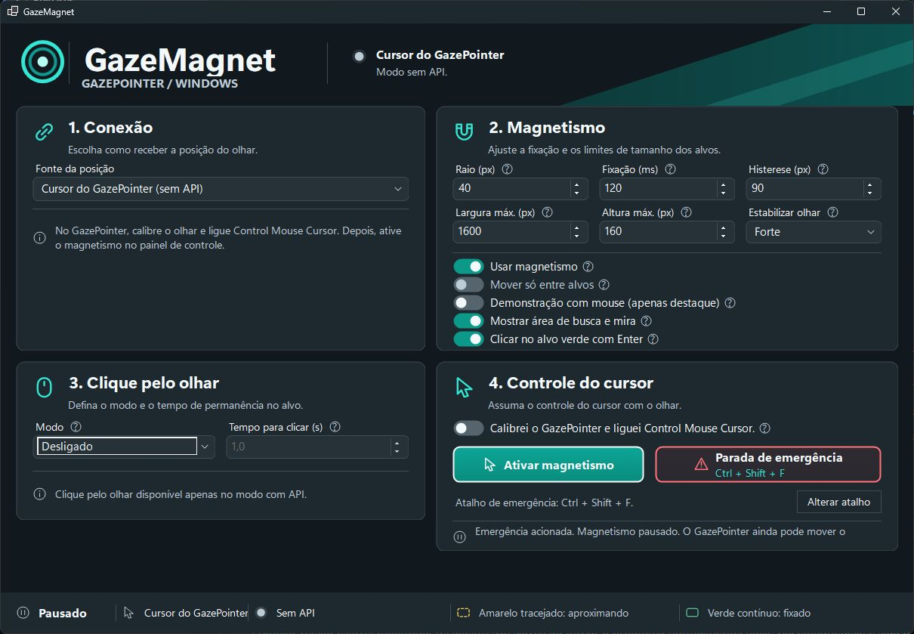

# GazeMagnet

**Cursor magnético pelo olhar no Windows 11, usando uma webcam comum e o GazePointer.**

O GazeMagnet é um projeto experimental de acessibilidade desenvolvido com ajuda de IA. Ele identifica botões e links próximos usando o Windows UI Automation e faz o cursor encaixar no alvo selecionado.

**[Baixar o GazeMagnet para Windows 11](https://github.com/erickbrito-01/GazeMagnet/releases/latest)** · [Guia detalhado](LEIA-ME.md)



## Escolha o modo de uso

| Modo | Como funciona | Como clicar |
| --- | --- | --- |
| **GazeFlowAPI** | O GazeMagnet recebe as coordenadas do olhar e move o cursor. Permite mover só entre alvos. | Mouse, Enter ou clique pelo olhar. |
| **Cursor do GazePointer (sem API)** | O GazePointer move o cursor, e o GazeMagnet encaixa o ponteiro quando confirma um alvo. | Mouse ou Enter. |

## Requisitos

- Windows 11 de 64 bits (x64) e uma webcam.
- [GazePointer](https://sourceforge.net/projects/gazepointer/) instalado e calibrado no monitor principal. Ele é o responsável pelo rastreamento ocular.
- [.NET 10 Desktop Runtime x64](https://dotnet.microsoft.com/download/dotnet/10.0) para executar o GazeMagnet. Na página da Microsoft, escolha **Desktop Runtime** para Windows x64.

## Instalar e conectar pela API

1. Baixe o **GazeMagnet.exe** na [página de releases](https://github.com/erickbrito-01/GazeMagnet/releases/latest).
2. Abra o GazePointer e calibre o olhar no monitor principal. Mantenha o rastreamento ligado, mas desligue **Control Mouse Cursor** (ícone de ponteiro). Desative também o marcador do olhar (ícone de olho) para evitar que ele cubra os controles.
3. Abra o GazeMagnet. Em **1. Conexão**, deixe **Configurar conexão automaticamente** marcada e clique em **Conectar**.
4. Se o GazePointer mostrar um pedido de acesso, confira o pedido e clique em **Allow** para autorizar. Aguarde o GazeMagnet indicar que está recebendo coordenadas.
5. Em **4. Controle do cursor**, confirme que fez a calibração e desligou o controle de cursor no GazePointer. Clique em **Assumir cursor**. Para devolver o controle ao mouse a qualquer momento, use **Parada de emergência** ou o atalho indicado no painel. O padrão é **Ctrl + Alt + F10**.

Com o controle pausado, use **Alterar atalho** para escolher e salvar outra combinação de emergência. Se a escolha estiver ocupada na próxima abertura, o GazeMagnet tenta usar o padrão e mostra no painel qual combinação está ativa. Se nenhuma estiver disponível, escolha outra antes de assumir o cursor.

### Usar o cursor do GazePointer sem API

1. No GazePointer, calibre o olhar, mantenha o rastreamento ativo e ligue **Control Mouse Cursor**.
2. No GazeMagnet, com o controle pausado e a API desconectada, escolha **Cursor do GazePointer (sem API)** em **1. Conexão**.
3. Em **4. Controle do cursor**, marque a confirmação e clique em **Ativar magnetismo**. O GazePointer move o ponteiro livremente e o GazeMagnet faz um encaixe ao confirmar um alvo próximo.

Use **Mostrar área de busca e mira** para acompanhar a busca. O raio, a fixação, a histerese, os limites de tamanho e a estabilização da mira se aplicam nesse modo. Você pode clicar normalmente ou ativar **Clicar no alvo verde com Enter**. **Clique pelo olhar** e **Mover só entre alvos** ficam disponíveis no modo com API.

Se o ponteiro sair do centro, o destaque verde some. O mesmo alvo pode encaixar novamente depois que o ponteiro sair da margem de histerese ou confirmar outro alvo. Se você mover o mouse, aguarde dois segundos e volte a mover o ponteiro com o olhar.

O atalho de emergência pausa o magnetismo. Para parar também o movimento pelo olhar, desligue **Control Mouse Cursor** no GazePointer.

O executável desta versão está sem assinatura digital. O Windows pode exibir um aviso do SmartScreen. Para conferir a integridade do download, compare o resultado de `Get-FileHash .\GazeMagnet.exe -Algorithm SHA256` com o SHA-256 na página da release. [Como o SmartScreen avalia downloads](https://learn.microsoft.com/en-us/windows/apps/package-and-deploy/smartscreen-reputation)

## Usar o magnetismo e o clique

- **Amarelo tracejado** indica um candidato. **Verde contínuo** indica que o cursor já grudou no alvo.
- Em **2. Magnetismo**, **Mostrar área de busca e mira** exibe o ponto do olhar e o raio usado para buscar controles. **Estabilizar olhar** reduz a oscilação. **Mover só entre alvos** mantém o cursor parado quando não há um novo alvo confirmado.
- Para experimentar o magnetismo sem câmera, marque **Demonstração com mouse (apenas destaque)** e aproxime o ponteiro de um botão. Desmarque essa opção para usar o olhar.
- Para clicar com o teclado, ative **Clicar no alvo verde com Enter**. O Enter mantém a função normal quando não há alvo fixado.
- Para experimentar o clique pelo olhar, selecione **Treino (sem clique)** em **3. Clique pelo olhar**. O preenchimento verde avança enquanto o alvo fixado estiver dentro do círculo. Em **Clique esquerdo**, o preenchimento completo dispara o clique. Afaste a mira até o alvo sair do círculo antes de repetir. **Ctrl + Alt + F11** pausa ou retoma o clique pelo olhar.

| Ajuste | Padrão | O que muda |
| --- | --- | --- |
| Raio | 56 px | Distância da borda do controle para atrair o cursor e contar o clique. |
| Fixação | 320 ms | Quanto tempo um candidato precisa permanecer selecionado antes de ficar verde. |
| Histerese | 24 px | Margem extra para manter o alvo fixado quando o olhar oscila. |
| Estabilizar olhar | Médio | Intensidade da suavização da mira e do cursor livre. |
| Tempo para clicar | 1,0 s | Quanto tempo o alvo precisa permanecer dentro do círculo depois de ficar verde. |

Ao fechar o GazeMagnet normalmente, ele salva seus ajustes e os restaura na próxima abertura. A chave manual, se informada, fica protegida pelo Windows na sua conta. O programa abre desconectado, com o cursor manual e o clique pelo olhar desligado. O atalho **Ctrl + Alt + F11** recupera o último modo de clique que você usou.

## Porta local, chave e reconexão

A configuração automática procura a porta do GazePointer no mesmo computador e usa a chave pública de teste `AppKeyDemo`. Para informar uma porta ou chave própria, desmarque **Configurar conexão automaticamente**. O endereço é `127.0.0.1`, e a porta padrão é **43333**. Se o GazePointer estiver em outra porta, confira o valor de `<port>` no arquivo `GazeStreamSettings.xml` da instalação. Use a mesma porta no GazeMagnet. [Documentação da GazeFlowAPI](https://github.com/szydej/GazeFlowAPI)

Na versão do GazePointer verificada durante o desenvolvimento, a chave demo limita a sessão a cerca de **10 minutos** e entrega cerca de **5 amostras por segundo**. Se a sessão cair ou expirar, o GazeMagnet tenta abrir outra até três vezes. O GazePointer pode pedir autorização novamente. O cursor só retoma o controle pelo olhar se já estava assumido e chegarem novas coordenadas estáveis. **Cancelar retomada** mantém o cursor manual. **Cancelar reconexão** interrompe as tentativas.

## Se algo falhar

| Sintoma | O que conferir |
| --- | --- |
| API indisponível | Confirme que o GazePointer está aberto e confira a porta local. |
| Acesso recusado | Revise a janela de autorização do GazePointer e a chave informada. |
| API conectada, sem coordenadas válidas | Confira a câmera, a posição do rosto e a calibração no monitor principal. |
| Um controle fica sem destaque | A detecção depende dos controles que cada aplicativo expõe ao Windows UI Automation. Interfaces personalizadas e janelas com privilégios elevados podem ter cobertura limitada. |

O GazeMagnet recebe as coordenadas pela conexão local e não as grava. A câmera é usada pelo GazePointer. Veja o [guia detalhado de operação e validação](LEIA-ME.md) para mais exemplos e limitações do MVP.

## Compilar a partir do código

Instale o [.NET 10 SDK](https://dotnet.microsoft.com/download/dotnet/10.0) para Windows. Na raiz do repositório, execute no PowerShell:

```powershell
dotnet build .\src\GazeMagnet.csproj -c Release
dotnet run --project .\src\GazeMagnet.csproj
```

## Créditos

O GazeMagnet foi desenvolvido por **Erick Brito** com ajuda de IA. O rastreamento ocular vem do [GazePointer](https://sourceforge.net/projects/gazepointer/), publicado no SourceForge por **szydej**. O GazePointer é instalado separadamente.

## Licença

O código e a documentação do GazeMagnet são disponibilizados sob a [licença MIT](LICENSE). O GazePointer e os componentes de terceiros mantêm suas próprias licenças.
